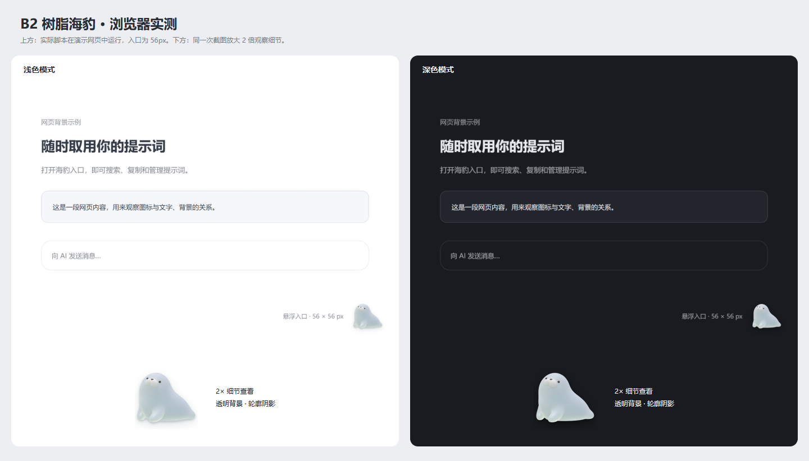
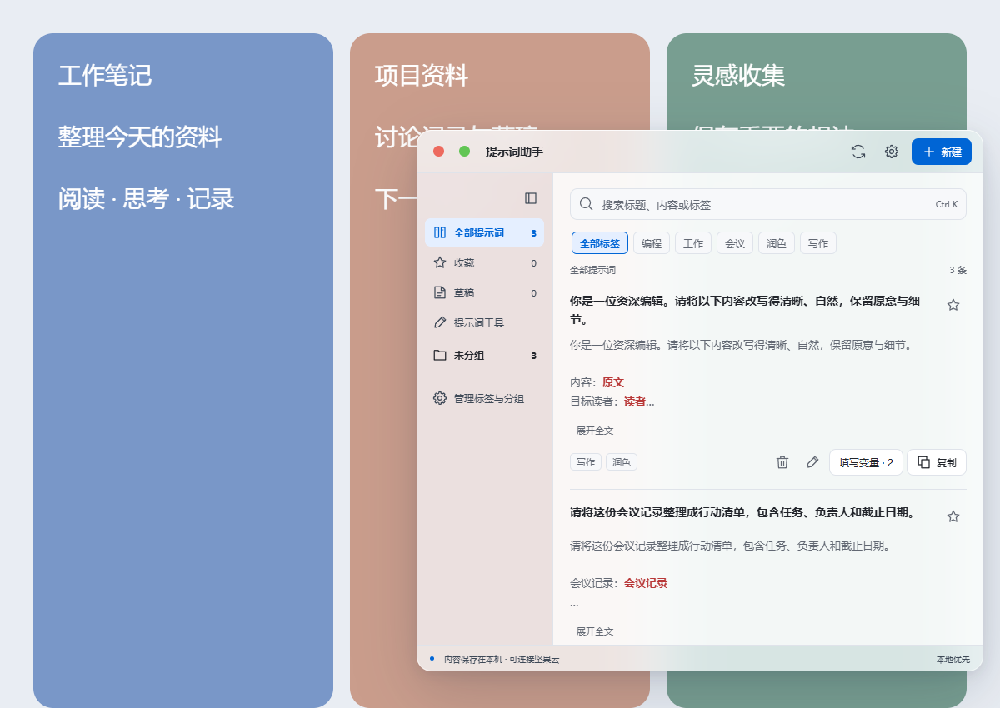
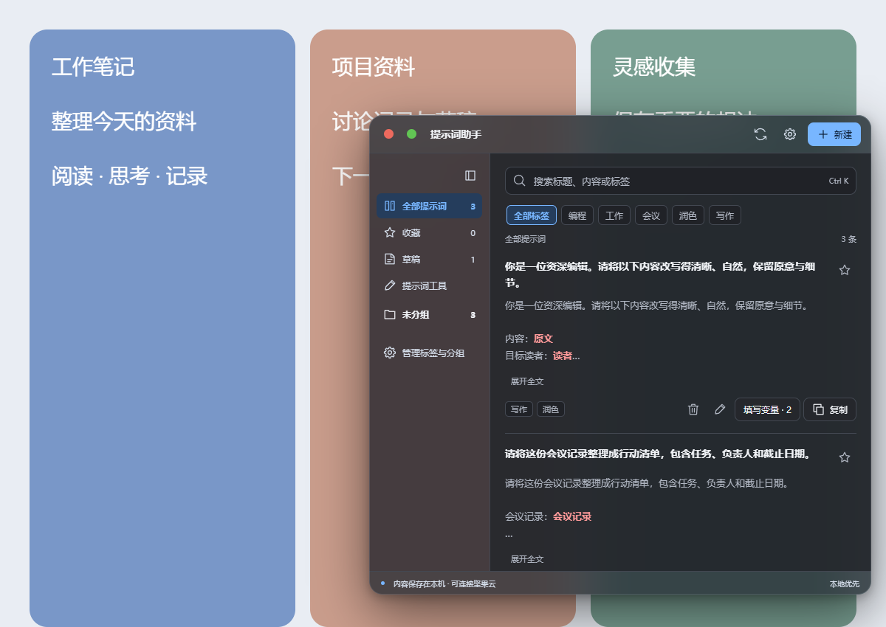

# 提示词助手


在 AI 网页旁保存、分组、检索和复用提示词的 Tampermonkey 用户脚本。支持变量填写、临时编辑、草稿、主题切换，以及可选的坚果云 WebDAV 同步。

[安装 / 更新 GitHub 最新版](https://raw.githubusercontent.com/wu66chen/prompt-helper/main/prompt-helper.user.js)

## 安装与升级

1. 在浏览器安装并启用 Tampermonkey。
2. 打开上面的安装链接，检查脚本名称后确认安装或更新。
3. 刷新已打开的 AI 网页，点击悬浮图标展开。

如果浏览器只显示源码，可以复制完整内容到 Tampermonkey 编辑器并保存。升级前建议导出一份提示词备份；更新同一个脚本，不要先卸载，也不要同时启用两个副本。3.x 会迁移同一脚本存储中的旧版提示词，并保留旧数据备份。

本仓库发布的是 3.8.2。GreasyFork 是独立发布渠道，此次 GitHub 更新不代表该渠道已同步。当前脚本关闭自动更新，后续版本可通过本页链接手动更新。

## 界面预览

半透明树脂海豹悬浮图标，适配浅色和深色主题。设置中可调整为 48–128px，默认 72px。



顶栏、侧栏和状态栏适度透出模糊的后方内容；正文使用较厚底色，输入框保持实色。以下为示例数据与本地测试网页的实际渲染。




## 主要功能

- **提示词资料库**：全文搜索、收藏、可换行的标签筛选、手动标签分组和自定义分组图标颜色。
- **变量与临时使用**：用 `{{变量名}}` 标记输入项，同名变量只需填写一次；可临时修改后复制，也可修改原模板。
- **编辑保护**：自动保存草稿、删除后撤销、导入前备份；同步发生并行修改时保留冲突版本供选择。
- **桌面窗口操作**：四边和四角均可缩放，顶栏和侧栏可拖动；从悬浮图标所在位置展开，保持窗口在浏览器可视范围内。
- **可选收起方式**：点击 ×、双击顶栏或侧栏、点击窗口外区域可独立勾选并组合使用。
- **主题与磨砂**：浅色、深色、跟随系统；可减少透明效果或关闭微动效，也尊重系统的减少动态效果偏好。
- **折叠侧栏**：切换成仅显示图标的小列，悬停或键盘聚焦时显示完整名称。
- **内置提示词工具**：一键复制“优化提示词”和“生成简短标题”的完整指令，粘贴到其他 AI 平台后再提供原文；脚本自身不调用 AI。
- **备份与同步**：JSON / TXT 导入导出，以及用户主动配置后启用的坚果云 WebDAV 同步。

## 跨网站与跨设备

同一浏览器、同一 Tampermonkey 脚本安装中的提示词和设置可跨支持的网站共用。主题、侧栏状态、透明效果等会实时更新；悬浮图标和窗口的位置、大小可选择共用，并按网页可视区域适配。

跨设备同步提示词，需要在各设备配置同一个坚果云同步文件。窗口布局、界面偏好和本地草稿不作为云端提示词数据上传。

## 坚果云同步

在坚果云账户的安全设置中创建供第三方应用使用的应用密码，然后打开脚本的 **设置 → 云同步**，填写坚果云账户、应用密码和同步文件配置。请使用应用密码，不要使用网页登录密码。

先测试连接，再执行首次手动同步；确认成功后可以启用自动同步。所有设备应指向同一个同步文件。首版仅支持坚果云，其他网盘尚未接入。

脚本使用远端版本校验降低并行覆盖风险；无法确认远端版本时会保留本地内容并停止覆盖上传。遇到冲突时可以查看并选择保留的版本。

## 数据与权限

- 默认保存在 Tampermonkey 本地存储。只有主动启用同步后才会向配置的坚果云地址发送提示词数据。
- 账户和应用密码保存在本机脚本存储中，不包含在提示词导出文件和云端同步文件中。
- 复制按钮只写入剪贴板，不会自动发送到网站；脚本不读取宿主网页的聊天内容。
- 卸载脚本、清理扩展数据或更换浏览器可能失去本地数据，请保留独立备份。
- 源码、内置图像和样式打包在一个用户脚本中，运行时无需下载外部图标或前端依赖。

支持范围由 [userscript-matches.json](userscript-matches.json) 定义，包括豆包、ChatGPT、DeepSeek、Kimi、Qwen、Gemini、Google AI Studio 等站点。脚本在顶层网页运行，不在 iframe 内重复创建窗口。

## 快捷操作

| 操作 | 方法 |
| --- | --- |
| 搜索 | 面板内 `Ctrl / ⌘ + K` |
| 保存或复制当前编辑 | `Ctrl / ⌘ + Enter` |
| 关闭确认弹窗或返回列表 | `Esc` |
| 复制提示词 | 点击正文或复制按钮 |
| 修改主题、透明效果和收起方式 | 顶栏齿轮 → 设置 |

## 开发与验证

使用 Node.js 18 或更高版本：

```sh
npm ci
npm run build
npm test
npm run test:ui
```

浏览器检查使用本机 Google Chrome（Playwright 的 `chrome` channel）。其他专项命令见 [package.json](package.json)，覆盖窗口、侧栏、设置共享、微动效、提示气泡和模拟 WebDAV 同步。

源码在 `src/`，站点清单在 `userscript-matches.json`；`npm run build` 生成仓库根目录的 `prompt-helper.user.js`，不依赖任何旧版备份文件。`artifacts/` 是本地测试输出，不提交个人备份或凭据。

自动化检查中的 WebDAV 服务为模拟环境，不代替真实账户连接测试。

## 更新记录

- **3.8.2**：悬浮图标大小调节、实时预览、跨网站同步和按尺寸适配的窗口对齐。
- **3.8.1**：半透明树脂海豹悬浮图标，适配浅深主题。

- **3.8.0**：分层磨砂玻璃、阅读区域底色保护、实色回退和减少透明效果支持。
- **3.7.0**：折页 Logo 随浅深主题切换。
- **3.6.0**：内置优化提示词与简短标题指令，突出复制入口。
- **3.5.x**：交互微动效、侧栏名称提示稳定性修复。
- **3.4.x**：所有网站共用设置，可选共享窗口位置和大小。
- **3.3.x**：侧栏折叠与拖动、自定义分组颜色、坚果云同步兼容性改进。
- **3.0–3.2**：新窗口界面、分组与设置、WebDAV 同步、四边四角缩放与收起方式组合。

## License

[MIT](LICENSE)
