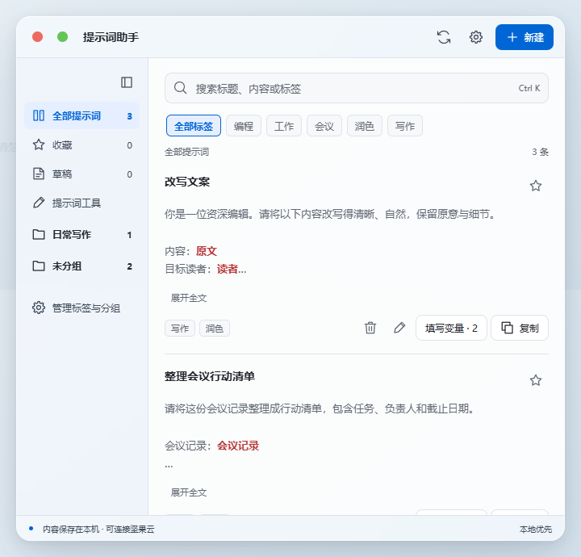

<p align="center">
  <picture>
    <source media="(prefers-color-scheme: dark)" srcset="assets/readme/seal-banner-dark.png">
    <source media="(prefers-color-scheme: light)" srcset="assets/readme/seal-banner-light.png">
    
  </picture>
</p>

# 提示词助手

常用提示词，随手可用。

面向经常使用 AI 网页的用户，在不同网站间保存、整理和复用提示词的 Tampermonkey 脚本；本地保存，按需连接坚果云。

[](LICENSE)

**[安装 / 更新到 3.8.4](https://raw.githubusercontent.com/wu66chen/prompt-helper/main/prompt-helper.user.js)** · [开始使用](#安装与更新) · [坚果云配置](docs/sync.md) · [使用指南](docs/usage.md)

**小海豹，常驻网页的一角。** 它也是实际使用中的悬浮入口：点击展开提示词窗口，拖动改变位置。大小可在设置中调整为 48–128px；浅深主题保留同一只海豹的树脂质感。[查看透明 Logo](assets/readme/seal.png)

<picture>
  <source media="(prefers-color-scheme: dark)" srcset="assets/readme/window-dark.png">
  <source media="(prefers-color-scheme: light)" srcset="assets/readme/window-light.png">
  
</picture>

截图使用示例提示词与本地演示页面。[浅色截图](assets/readme/window-light.png) · [深色截图](assets/readme/window-dark.png)

## 能做什么

- **把常用内容放在一起**：全文搜索、收藏、标签筛选；标签可手动分组，并为分组设置图标颜色。
- **一份模板反复使用**：用 `{{变量名}}` 留出待填写内容，使用时填入变量、临时编辑，再复制到 AI 网页。
- **像桌面窗口一样操作**：拖动顶栏或侧栏移动，四边四角调整大小；从悬浮入口原地展开，适配浏览器可视范围。
- **按自己的习惯调整**：浅色、深色、跟随系统；磨砂透明效果、微动效、折叠侧栏，以及可组合的收起方式。
- **海豹入口大小可调**：半透明树脂海豹，默认 72px，可调至 48–128px；设置实时预览，并在本浏览器的支持网站间共用。
- **保留编辑与迁移余地**：自动保存草稿、删除后撤销、JSON 备份、旧版 TXT 导入，以及可选的坚果云同步。

## 安装与更新

1. 安装并启用 [Tampermonkey](https://www.tampermonkey.net/)。普通使用无需 Node.js，也无需配置坚果云。
2. 打开 **[脚本安装链接](https://raw.githubusercontent.com/wu66chen/prompt-helper/main/prompt-helper.user.js)**，在 Tampermonkey 中确认安装或更新。
3. 刷新已打开的受支持网页，点击海豹悬浮图标展开窗口。

支持 ChatGPT、豆包、DeepSeek、Kimi、Qwen、Gemini、Google AI Studio 等网站；完整域名范围见 [站点清单](userscript-matches.json)。脚本只在匹配的顶层页面运行。

> [!IMPORTANT]
> 更新前可在「设置 → 备份」导出 JSON。更新同一个脚本，不要先卸载，也不要同时启用两个副本。当前版本关闭自动更新，后续仍通过本页链接手动更新。

<details>
<summary>打开安装链接后，只看到了源码？</summary>

复制完整源码，在 Tampermonkey 编辑器中新建脚本或覆盖已有脚本，然后保存并刷新网页。升级时保留原脚本名称与命名空间。仍未出现入口时，检查扩展是否启用、是否允许在当前站点运行，以及当前域名是否在站点清单中。

</details>

## 第一次使用

**保存一份模板。** 点击「新建」，填写标题，例如“改写文案”，粘贴下面的内容，并添加“写作、润色”标签后保存：

```text
请将以下内容改写得清晰、自然，保留原意与细节。

内容：{{原文}}
目标读者：{{读者}}

请先给出改写版本，再简要说明修改理由。
```

**填好再复制。** 找到模板，点击「填写变量 · 2」，填写“原文”和“读者”，复制结果后粘贴到 AI 网页。相同变量只需填写一次；脚本不会自动发送消息。

**整理常用内容。** 在「管理标签与分组」中建立分组，把标签拖入分组或通过下拉菜单分配；在列表中按分组、标签或关键词查找。

侧栏还有「提示词工具」：一键复制“优化提示词”或“生成简短标题”的通用指令，交给其他 AI 平台使用。脚本自身不调用 AI。

更多操作见 [使用指南](docs/usage.md)，包括快捷键、草稿、备份和全部设置的默认值。

## 跨网站共用与云同步

| 内容 | 同一浏览器、同一脚本安装 | 跨浏览器或设备 |
| --- | --- | --- |
| 提示词、收藏、标签与分组 | 自动共用 | 可通过坚果云同步，也可导入 JSON |
| 主题、海豹大小等界面偏好 | 共用，修改后其他已打开页面同步更新 | 不通过坚果云同步 |
| 悬浮入口和窗口的位置、大小 | 默认共用，可改为各网站分别记忆 | 不通过坚果云同步 |
| 草稿、坚果云账号与应用密码 | 保存在当前脚本的本机存储中 | 不上传到云端提示词文件 |

坚果云是可选项。需要跨设备同步时，按 **[坚果云配置指南](docs/sync.md)** 创建应用密码，保存配置、测试连接，再执行首次手动同步。当前仅支持坚果云，尚未接入其他网盘。

## 数据与权限

提示词默认保存在 Tampermonkey 本地存储。配置坚果云后，手动同步或启用自动同步才会传输提示词数据；账号和应用密码不会进入导出文件或云端提示词文件。

云端 JSON 为明文，HTTPS 保护传输过程，**不属于端到端加密**。卸载脚本、清理扩展数据或更换浏览器可能丢失本地数据，请保留独立备份。

脚本不读取网页聊天内容，复制操作只写入剪贴板。代码、样式和图标都内嵌在单个脚本中，运行时无需下载外部界面资源。

## 开发与反馈

源码位于 `src/`，发布文件为根目录的 [`prompt-helper.user.js`](prompt-helper.user.js)。开发需要 Git、Node.js 与 npm；浏览器测试另需本机 Google Chrome。安装、构建和测试命令见 **[开发指南](docs/development.md)**。

发现问题或希望改进功能，可提交 [Issue](https://github.com/wu66chen/prompt-helper/issues)；请附上脚本版本、浏览器版本和复现步骤，并移除账号、应用密码及私人提示词。欢迎提交附有说明与验证结果的 Pull Request。

## 更新记录

- **3.8.4**：小幅提亮海豹入口与设置预览，保留轻投影并减弱悬停时额外提亮的幅度。
- **3.8.3**：减轻海豹悬浮入口的轮廓投影，避免浅色网页上的灰黑光晕；设置预览同步调整。
- **3.8.2**：悬浮图标大小调节、实时预览、跨网站同步和按尺寸适配的窗口对齐。
- **3.8.1**：半透明树脂海豹悬浮入口，适配浅深主题。
- **3.8.0**：分层磨砂玻璃、正文阅读保护、减少透明效果与实色回退。

<details>
<summary>更早的版本</summary>

- **3.7.0**：随浅深主题切换的折页 Logo，已由海豹替代。
- **3.6.0**：内置优化提示词与简短标题指令。
- **3.5.x**：交互微动效、侧栏名称提示稳定性修复。
- **3.4.x**：所有网站共用设置，可选共享窗口位置和大小。
- **3.3.x**：侧栏折叠与拖动、自定义分组颜色、坚果云同步兼容性改进。
- **3.0–3.2**：新窗口界面、分组与设置、WebDAV 同步、四边四角缩放与收起方式组合。

</details>

## 许可

[MIT](LICENSE)
