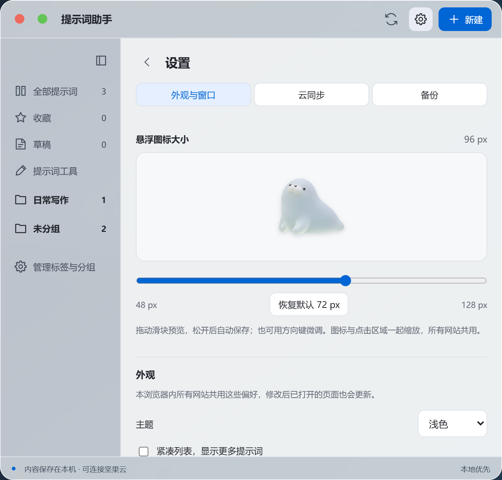

# 使用指南

[返回首页](../README.md)

## 保存、查找与复用

点击「新建」，填写标题、内容和标签，保存后即可在列表中查找。标签支持用逗号分隔。搜索会匹配标题、正文和标签；多个关键词同时参与筛选。

无需填写变量时，可以直接复制提示词；含 `{{变量名}}` 的模板先点击「填写变量」，填入变量再复制。同名变量只显示一个输入项。临时编辑适合只改这一次的输出，需要长期保留的调整则修改原模板。

各处复制使用同一套处理：先显示「正在复制」，完成后才显示成功；自动复制失败时会显示已选中的完整正文，按 `Ctrl / ⌘ + C` 手动复制。空内容不会写入剪贴板。浏览器已授予剪贴板读取权限时，会在本机比对写入结果；不会为了校验额外请求读取权限，也不会保存或上传剪贴板内容。

「优化 Prompt」提供优化人工编写的提示词、生成简短标题、生成提示词标签三段通用指令。点击对应的复制按钮，到其他 AI 平台粘贴并提供原文，生成过程由所选平台完成。生成标签时可以附上已有标签列表，优先复用相同分类；结果为中文逗号分隔的一行短标签，可直接粘贴到编辑页的标签栏。

工具卡片的「编辑」可修改名称、简短说明与完整正文。内置工具修改后出现「恢复内置」，可恢复当前版本的默认内容；自定义工具通过「添加工具」创建，可编辑或删除，删除与恢复内置后均可短暂撤销。复制始终使用当前保存的正文，并原样保留其中的 `{{变量名}}`。

编辑工具时可主动点击「存草稿」；有未保存改动时离开会提示放弃或存草稿，未改不生成草稿。`Ctrl / ⌘ + Enter` 保存，`Esc` 按访问路径返回上一级。如果另一个页面已修改或删除该工具，会阻止旧编辑覆盖新内容，可点击「另存为新工具」保留自己的版本。

工具内容在同一浏览器的同一脚本安装中共用，并随坚果云和 JSON 备份迁移。3.11.0 自动把旧版本仅保存在本机的工具修改迁入同步历史，原始本机数据仍保留。修改过的内置工具、自定义工具、删除和恢复内置操作都会同步；3.14.0 起已保存草稿也参与同步。未修改的内置工具使用脚本自带版本，已修改的工具可以通过「恢复内置」获取当前默认内容。

多设备并行修改会保留多个版本，可在工具列表中选择「保留此版本」。修改与删除／恢复内置发生冲突时，也可选择「确认删除」或「使用内置版本」。删除冲突中的单个版本不会丢弃其余版本。旧备份不会复活已被后续历史删除的工具。所有参与同步的设备需更新至 3.15.0 或更高版本。

默认优化指令按脚本的文本变量机制设计：例如把 `1:1` 转成 `{{输出比例}}`，重复出现时使用同一变量名；在资料库保存生成的模板后，点击「填写变量」输入 `1:1`、`16:9` 等值，再复制执行。附件直接在目标 AI 平台上传，不用 `{{原始图片}}` 代替图片。变量只有 `{{名称}}` 语法，不支持默认值、下拉选项或条件表达式。外部 AI 的生成结果仍应检查，必要时可在编辑器选中文字「设为变量」。

编辑提示词或工具正文时，完整的 `{{变量名}}`（含大括号）会显示为红色；尚未闭合或跨行的标记按普通文本显示。「填写并使用」下方正文同样标红变量名和已填写的替换值；直接编辑正文时，高亮范围跟随文字变化。资料库摘要和全文预览也保留变量着色。高亮不会改变保存和复制的原文。编辑框保留原生输入、选择、粘贴和撤销；使用系统强制颜色模式时回退为系统文字颜色。

## 提示词库排列方式

在「设置 → 外观与窗口 → 提示词库排列方式」选择：

- **等高网格（推荐默认）**：卡片等宽等高，完整显示标题和正文摘要，操作位置对齐，适合日常查找与复制。点击标题或「查看全文」打开预览，不会撑高整排卡片。
- **纯标题网格**：保留完整标题、收藏和一键复制等操作按钮，隐藏正文与标签。移除固定的最小高度，按标题实际行数收紧卡片，减少空白。适合已熟悉标题、希望快速定位的资料库；点击标题查看全文。
- **瀑布流**：使用等宽卡片，标题完整换行显示；正文默认节选四行，多余内容省略，可点击「展开全文」。卡片按当前排序依次放入最短的一列，随窗口缩放、侧栏折叠和正文展开重新排列；窄窗口自动变为一列。
- **单列列表**：沿用原来的纵向列表，适合逐条阅读。

四种排列都支持搜索、标签筛选、收藏、填写变量、复制和编辑。卡片底部的删除、编辑、填写变量／临时编辑、复制保持在同一行。网格列数随窗口宽度调整；标题始终完整换行，长标题会增加等高卡片的高度。开启「紧凑显示」可缩小间距，并把正文摘要缩为两行。

新安装或尚未保存排列偏好时默认等高网格；升级会保留已有的有效选择。排列偏好在本浏览器各网站实时共用并在刷新后保留，连接坚果云后也会跨设备同步。全文预览中也可复制内容或进入变量填写。

## 标签与分组

打开「管理标签与分组」后，可新建分组，把标签拖入分组，或使用标签旁的下拉菜单。每个标签旁显示其提示词数量。拖到标签或分组的上半部／下半部，会在其上方／下方插入，蓝线标示落点；也可用上下箭头调整顺序，标签箭头只在所属分组内移动；点击分组颜色方块改变其图标颜色。删除标签不会删除提示词。

侧栏顶部的折叠按钮可将侧栏缩成仅显示图标的一列。悬停或键盘聚焦时显示完整名称。

## 悬浮图标与窗口

拖动海豹改变入口位置，点击后从该位置展开窗口；默认向左上展开，空间不足时改用其他方向。对应的左右边、上下边保持对齐；拖动窗口后，收起的海豹也会跟到新位置。

拖动顶栏或侧栏移动窗口，四边和四角均可缩放。绿色控制点切换最大化与还原；窗口会适配浏览器可视范围。

在「设置 → 外观与窗口」调整海豹大小。滑块范围为 **48–128px**，每次 **4px**；预览随拖动变化，松开后保存，也可用方向键微调。点击「恢复默认 72 px」还原。

在同一设置页可选择自定义 PNG，或恢复小海豹。推荐 **256 × 256 / 512 × 512 像素、透明底、主体居中且留白较少**；文件最大 **1 MB**，宽高均需为 **64–2048 像素**。保存时最长边缩至 256 像素并保留透明度。图标作为内嵌数据保存，不请求外部图片地址，并随坚果云和完整 JSON 同步。

## 网站管理

打开「设置 → 网站」：

- **暂时关闭默认网站**：在「默认网站」取消勾选对应域名，刷新该网站即可隐藏海豹。重新勾选可恢复；关闭支持不会删除提示词。
- **添加自定义网站**：输入域名或粘贴 HTTP / HTTPS 网页地址，点击「添加网站」。可勾选「同时支持此域名的子域名」，例如 `example.com` 同时覆盖 `chat.example.com`。
- **停用或删除自定义网站**：名称旁的复选框控制启用状态；「删除」移除规则。下方的「包含子域名」可以随时调整，IP 地址和 localhost 不适用。
- **当前网页没有海豹**：点击浏览器工具栏的 Tampermonkey 图标，打开当前脚本的「提示词助手：网站管理」菜单，点击「启用当前网站」，然后刷新网页。该入口也能恢复被全部关闭的网站名单。

按域名管理，不区分路径、协议和端口；例如 `https://example.com/chat` 和 `http://example.com:8080/` 使用同一条 `example.com` 规则。默认网站包含各自的子域名，自定义网站默认只匹配输入的域名；最多添加 200 个自定义网站。

更具体的域名规则优先于父域名规则（包括默认网站）。例如 `aistudio.google.com` 仍由默认网站中的对应开关控制，不受更宽泛的 `google.com` 自定义规则覆盖。例如启用 `example.com` 及其子域名后，可另加 `private.example.com` 并取消勾选，单独排除它。删除这条排除规则会重新遵循父域名的启用状态。

修改立即保存，**刷新目标网页后改变入口显示**；已打开窗口会保留，避免打断编辑。网站名单在本浏览器的同一脚本安装中共用，也包含在坚果云同步和完整 JSON 备份中。

自定义网站依赖 Tampermonkey 的网站运行权限。3.9.0 起，脚本匹配所有普通 HTTP / HTTPS 顶层网页，然后按名单决定是否启动；未启用时仅检查名单、注册恢复菜单。主动打开网站管理会加载设置界面，仍不会在未启用的网站自动同步。浏览器内部页面和扩展页面不支持。

## 设置默认值

以下为全新安装的默认值；升级会保留已有偏好。

| 位置 / 设置 | 默认值 | 作用 |
| --- | --- | --- |
| 外观与窗口 / 全局字体大小 | 14px | 12–20px，实时生效、自动保存、可恢复默认，随坚果云 / JSON 迁移 |
| 外观与窗口 / 悬浮图标大小 | 72px | 调整图标和点击区域，范围 48–128px |
| 外观与窗口 / 主题 | 跟随系统 | 也可固定为浅色或深色 |
| 外观与窗口 / 提示词库排列方式 | 等高网格 | 另有纯标题网格、瀑布流、单列列表；升级保留已有选择 |
| 外观与窗口 / 紧凑显示 | 关闭 | 缩小间距与正文摘要行数，适用于四种排列 |
| 外观与窗口 / 减少透明效果 | 关闭 | 开启后使用实色背景 |
| 外观与窗口 / 启用微动效 | 开启 | 同时尊重系统的减少动态效果偏好 |
| 外观与窗口 / 点击 × 收起 | 开启 | 点击窗口红色控制点收起 |
| 外观与窗口 / 双击顶栏或侧栏收起 | 关闭 | 可与其他收起方式组合 |
| 外观与窗口 / 点击窗口外区域收起 | 关闭 | 可与其他收起方式组合 |
| 外观与窗口 / 共用位置、大小 | 开启 | 本浏览器内按可视区域比例适配，关闭后各网站分别记忆 |
| 侧栏 / 折叠状态 | 展开 | 切换为仅显示图标 |
| 网站 / 默认网站 | 全部启用 | 支持范围见[默认站点清单](../userscript-matches.json)，包含子域名 |
| 网站 / 自定义网站 | 空 | 新增域名默认不包含子域名，可单独勾选 |
| 云同步 / 账号、应用密码 | 未填写 | 配置方法见[云同步指南](sync.md) |
| 云同步 / 同步文件夹 | `PromptHelper` | 多设备填写同一文件夹 |
| 云同步 / 自动同步 | 关闭 | 需先保存有效配置 |

界面偏好在本浏览器的同一脚本安装中共用，连接坚果云后也会跨设备同步。关闭所有收起方式后，窗口会保持展开；可返回设置重新勾选。

## 快捷操作

| 操作 | 方法 |
| --- | --- |
| 面板内搜索 | `Ctrl / ⌘ + K` |
| 保存或复制当前编辑 | `Ctrl / ⌘ + Enter` |
| 关闭确认弹窗或按访问路径返回上一级 | `Esc` |
| 切换控件 | `Tab` |
| 调整海豹大小 | 聚焦尺寸滑块后按方向键 |

## 草稿、备份与迁移

新建提示词、修改原模板、填写变量／临时编辑、新建／修改工具采用相同规则：没有改动则直接离开，不新增草稿；内容有改动时提示“如果返回，你编辑的内容将丢失。”，选择红色「放弃」或「存草稿」，按 Esc 留在编辑页。也可随时点击页底「存草稿」。改回进入页面时的原值，不再提示。清空变量输入会恢复正文中的变量名称；需要删除正文片段时可直接编辑下方内容框。

草稿首页用「新建提示词」「修改原模板」「填写变量」「临时编辑」「新建工具」「修改工具」区分来源。继续编辑后选择「放弃」只放弃本次未保存修改，原先明确保存的草稿仍保留；删除请用「删除草稿」。已保存草稿随坚果云／完整 JSON 迁移，并行编辑保留多个版本。旧版本已生成的本机恢复缓存仍会迁移，不会自动清除。

收起窗口仅保留当前页面内的编辑状态，不静默存草稿；重新展开可继续。刷新／关闭网页时，有未保存修改会申请浏览器的离开提醒，具体弹窗由浏览器控制；浏览器崩溃等情况不能依赖它恢复，请主动存草稿。

返回按钮和 Esc 按实际访问路径逐级返回，例如「全部提示词 → 草稿 → 继续编辑」先回草稿，再回资料库；保存完成也回到进入编辑的页面。搜索词、分组／标签筛选、正文展开和滚动位置在本次页面会话中恢复。历史最多保留 40 步，不跨刷新或云同步；不会重新打开已经放弃的编辑页面。

打开「设置 → 备份」：

- **导出完整备份**：生成 JSON，包含提示词、收藏、标签分组、工具提示词、使用偏好、自定义图标、草稿和修改历史；不包含坚果云账号与应用密码。
- **导入 JSON / 旧版 TXT**：合并导入，不清空现有内容；导入前保留一份本地快照。
- **导出可读文本**：适合阅读或另存文字；保留完整信息的迁移优先使用 JSON。

升级时保留同一脚本安装，先导出独立备份。3.x 会迁移同一脚本存储中的旧版提示词并保留旧数据备份。删除后可通过临时提示撤销；云同步出现并行修改时会保留冲突版本，供手动选择。
